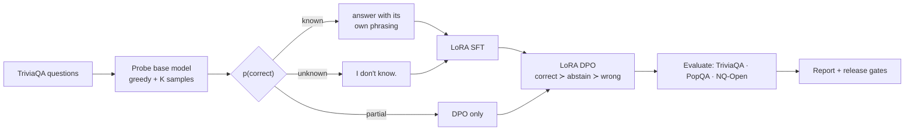

# llm-abstention-tuning

**Teaching a small LLM to say "I don't know" instead of hallucinating — with SFT + DPO post-training, calibration and risk–coverage evaluation.**

A hallucination is a confident answer to a question the model cannot actually answer. This project post-trains
`Qwen2.5-1.5B-Instruct` so that it **answers what it knows and abstains on what it doesn't**, then measures whether
that holds up: in- and out-of-distribution, against a prompt-only baseline, and against simply thresholding the base
model's own confidence.

[](https://github.com/manojrevenkar12-web/llm-abstention-tuning/actions/workflows/ci.yml)

## Results

> **Pending first full run.** Every number will be generated by `abstention-tuning report` into
> [`results/`](results/) — nothing here is written by hand. Run it yourself with the Colab notebook below.

| TriviaQA (in-distribution) | Accuracy | Hallucination | Abstention | Selective accuracy |
|---|---|---|---|---|
| Base | — | — | — | — |
| Base + "say I don't know" prompt | — | — | — | — |
| SFT | — | — | — | — |
| SFT + DPO | — | — | — | — |

## Method



1. **Probe what the model knows.** For each training question the base model gives one greedy answer and K sampled
   answers (plain prompt, no permission to abstain). The share of correct samples, p(correct), labels the question
   `known` (≥ 0.6 and greedy correct), `unknown` (never correct) or `partial`. Abstention is taught relative to *this
   model's* knowledge, not to question difficulty in general.
2. **SFT on the model's own answers.** Known → the model's own most frequent correct phrasing; unknown →
   `I don't know.` The gold string is never used as a target: fine-tuning on facts the model doesn't already hold is
   linked to *more* hallucination (Gekhman et al., 2024), so SFT only teaches **when** to answer, never **what**.
   Loss is on completion tokens only.
3. **DPO on a disjoint question set** (stratified split), with the preference order *correct ≻ abstain ≻ wrong*:
   known → `correct ≻ I don't know` (penalises over-refusal) and `correct ≻ own wrong sample`; unknown →
   `I don't know ≻ own most frequent hallucination`; partial → `correct ≻ wrong`. The reference policy is the SFT model.
4. **Evaluate with the plain prompt.** The trained models are never told they may abstain, so any abstention is in the
   weights, not the prompt.

### Baselines that the tuned model has to beat

| Baseline | Question it answers |
|---|---|
| `base` | How often does the untouched model hallucinate? |
| `base_prompted` | Can a system prompt ("if unsure, say I don't know") do the job without training? |
| **matched-coverage threshold** | If the base model abstained on its *least confident* answers exactly as often as the tuned model abstains, would it do just as well? If yes, training added nothing a confidence threshold couldn't. |
| `sft` vs `sft_dpo` | Does DPO add anything over SFT alone? |

### Metrics

| Metric | Definition |
|---|---|
| Hallucination rate | wrong answers / all questions |
| Abstention rate | "I don't know" (or equivalent) / all questions |
| Selective accuracy | correct / answered — precision of what the model does say |
| Net score | accuracy − hallucination rate (a wrong answer costs as much as a right one earns) |
| Over-abstention | refusals on questions the base model reliably knows |
| Unknown hallucination | wrong answers on questions the base model never gets right |
| ECE | expected calibration error of answer confidence (exp of mean token log-prob), answered items |
| AURC / coverage @ 90 % precision | risk–coverage curve when further abstaining on the least confident answers |

All rates carry 95 % bootstrap confidence intervals. Out-of-distribution sets: **PopQA** (long-tail entities, where a
1.5B model knows little) and **NQ-Open** (search-engine questions).

### Release gates

[`configs/gates.yaml`](configs/gates.yaml) was written *before* the first full run. Blocking gates: ≥ 30 % relative
reduction in in-distribution hallucination, ≤ 5-point accuracy drop, ≤ 15 % over-abstention. Warning gates: OOD
transfer, beating the matched-coverage threshold, beating the prompt-only baseline, DPO beating SFT.
`abstention-tuning gates` exits non-zero on a blocking failure, the same way a CI quality gate would. Failing gates
are reported, not tuned away.

## Reproduce

**Colab (recommended):** open [`notebooks/colab_run.ipynb`](notebooks/colab_run.ipynb). Each stage is one cell and
writes to Google Drive, so a disconnect only costs the current stage. Use `configs/qwen2.5-1.5b.yaml` on an L4/A100 or
`configs/qwen2.5-1.5b-quick.yaml` on a free T4.

**Locally / any GPU box:**

```bash
pip install -e ".[train,dev]"            # or: pip install -r requirements.txt && pip install -e .
abstention-tuning all --config configs/qwen2.5-1.5b.yaml
# or stage by stage: prepare, probe, build, sft, dpo, evaluate, gates, report
abstention-tuning all --config configs/qwen2.5-1.5b.yaml --from-stage evaluate   # resume
```

Output lands in `runs/<run_name>/`: probe labels, SFT/DPO datasets, LoRA adapters and merged models, per-question
predictions, `eval/metrics.json`, and `report/REPORT.md` with figures.

**Multi-GPU:** the training stages use the Hugging Face Trainer via TRL, so `accelerate launch -m abstention_tuning
sft --config ...` runs data-parallel without code changes. The reported runs used a single GPU.

## Engineering

- **Typed config** (Pydantic) — every run writes `config.resolved.yaml` next to its results.
- **Stage-by-stage pipeline** — each stage reads the previous stage's files, so any stage re-runs on its own.
- **Tests** — unit tests for grading, abstention detection, metrics (ECE, AURC, matched coverage, bootstrap), data
  builders, probing and gates, plus an **end-to-end smoke test** that builds a tiny random Qwen2-architecture model
  offline and runs probe → SFT → DPO → evaluate → gates → report on CPU in about 30 s. CI runs all of it on every push.
- **Deterministic grading** — SQuAD-style normalisation with word-boundary alias matching; no LLM judge, so no judge
  noise or self-preference.

```text
src/abstention_tuning/
  config.py       typed run config            probe.py      knowledge probing + labels
  data.py         TriviaQA / PopQA / NQ loaders builders.py   SFT + DPO data
  grading.py      answer + abstention grading train.py      LoRA SFT / DPO with TRL
  generation.py   batched generation + conf.  evaluate.py   systems × datasets + matched baseline
  metrics.py      rates, ECE, risk–coverage   gates.py      release gates
  report.py       REPORT.md + figures         pipeline.py / cli.py
configs/  notebooks/  scripts/make_tiny_model.py  tests/
```

## Limitations

- **One small model, single GPU.** Results are for a 1.5B model; larger models know more, so their known/unknown split
  and the size of the effect will differ.
- **Short-form factual QA only.** This is closed-book trivia, not long-form generation or RAG grounding.
- **Rule-based grading under-counts correct paraphrases** missing from the alias lists. It affects every system equally,
  so comparisons stay fair, but absolute accuracy is a slight under-estimate.
- **Confidence is mean token probability**, a cheap signal. Sample consistency or a trained probe would likely
  calibrate better.
- **DPO pairs come from the base model's samples**, not re-sampled from the SFT model (slightly off-policy).
- **Knowledge labels are estimates** from K samples; with K = 8 a fact recalled 1 time in 20 can be labelled unknown.

## Related work

- Zhang et al., 2024 — *R-Tuning: Instructing Large Language Models to Say "I Don't Know"* (NAACL).
- Gekhman et al., 2024 — *Does Fine-Tuning LLMs on New Knowledge Encourage Hallucinations?* (EMNLP).
- Yang et al., 2023 — *Alignment for Honesty*.
- Kadavath et al., 2022 — *Language Models (Mostly) Know What They Know*.
- Rafailov et al., 2023 — *Direct Preference Optimization*.
- Geifman & El-Yaniv, 2017 — *Selective Classification for Deep Neural Networks* (risk–coverage).

## License

MIT
