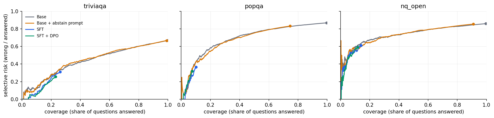
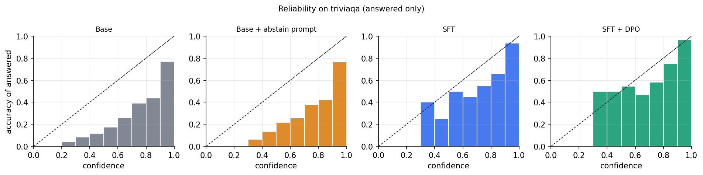
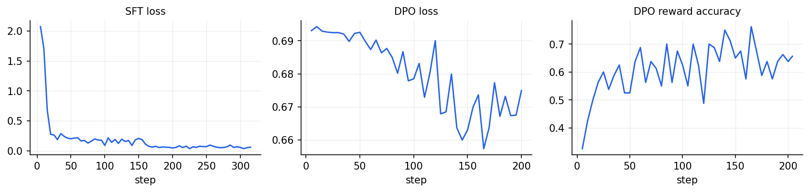

# Results — qwen2.5-1.5b

Base model: `Qwen/Qwen2.5-1.5B-Instruct`. Every number below is generated from `eval/metrics.json` by `abstention-tuning report`; nothing is hand-edited.

## Headline

On **triviaqa** (in-distribution), SFT + DPO changed the hallucination rate from 66.8% to 5.9% (a 91% relative reduction), accuracy from 33.2% to 17.1%, and abstained on 77.0% of questions. Selective accuracy (precision of answers given) went from 33.2% to 74.3%.


## triviaqa (in-distribution)

| System | Accuracy | Hallucination | Abstention | Selective acc. | Net score | ECE | AURC | Coverage @ 90% precision | Over-abstention (known) | Hallucination (unknown) |
|---|---|---|---|---|---|---|---|---|---|---|
| Base | 33.2% (30.3%–36.1%) | 66.8% (63.9%–69.7%) | 0.0% (0.0%–0.0%) | 33.2% | -0.336 | 0.320 | 0.435 | 6.0% | 0.0% | 100.0% |
| Base + abstain prompt | 33.0% (30.2%–35.8%) | 66.1% (63.3%–69.0%) | 0.9% (0.4%–1.5%) | 33.3% | -0.331 | 0.326 | 0.437 | 8.5% | 0.3% | 98.2% |
| SFT | 18.0% (15.7%–20.4%) | 8.1% (6.3%–9.8%) | 73.9% (71.3%–76.5%) | 69.0% | +0.099 | 0.126 | 0.133 | 13.1% | 41.6% | 10.0% |
| SFT + DPO | 17.1% (14.7%–19.5%) | 5.9% (4.4%–7.4%) | 77.0% (74.5%–79.6%) | 74.3% | +0.112 | 0.083 | 0.100 | 13.2% | 44.7% | 7.2% |

Matched-coverage baseline — the base model abstaining on its least-confident answers at the same rate:

| System | Coverage | Selective acc. (system) | Selective acc. (base, same coverage) | Hallucination (system) | Hallucination (base, same coverage) |
|---|---|---|---|---|---|
| Base + abstain prompt | 99.1% | 33.3% | 33.5% | 66.1% | 65.9% |
| SFT | 26.1% | 69.0% | 66.3% | 8.1% | 8.8% |
| SFT + DPO | 23.0% | 74.3% | 70.0% | 5.9% | 6.9% |

## popqa (out-of-distribution)

| System | Accuracy | Hallucination | Abstention | Selective acc. | Net score | ECE | AURC | Coverage @ 90% precision | Over-abstention (known) | Hallucination (unknown) |
|---|---|---|---|---|---|---|---|---|---|---|
| Base | 13.2% (11.0%–15.2%) | 86.4% (84.3%–88.6%) | 0.4% (0.1%–0.8%) | 13.3% | -0.732 | 0.358 | 0.685 | 3.7% | 0.0% | 99.5% |
| Base + abstain prompt | 12.6% (10.5%–14.7%) | 62.0% (59.2%–64.9%) | 25.4% (22.6%–28.1%) | 16.9% | -0.494 | 0.368 | 0.625 | 3.6% | 6.6% | 70.3% |
| SFT | 6.4% (4.9%–8.1%) | 3.7% (2.6%–4.8%) | 89.9% (87.9%–91.7%) | 63.4% | +0.027 | 0.181 | 0.170 | 3.1% | 44.6% | 4.0% |
| SFT + DPO | 5.1% (3.7%–6.6%) | 2.4% (1.5%–3.4%) | 92.5% (90.7%–94.1%) | 68.0% | +0.027 | 0.145 | 0.146 | 3.3% | 56.2% | 2.5% |

Matched-coverage baseline — the base model abstaining on its least-confident answers at the same rate:

| System | Coverage | Selective acc. (system) | Selective acc. (base, same coverage) | Hallucination (system) | Hallucination (base, same coverage) |
|---|---|---|---|---|---|
| Base + abstain prompt | 74.6% | 16.9% | 17.3% | 62.0% | 61.7% |
| SFT | 10.1% | 63.4% | 57.4% | 3.7% | 4.3% |
| SFT + DPO | 7.5% | 68.0% | 68.0% | 2.4% | 2.4% |

## nq_open (out-of-distribution)

| System | Accuracy | Hallucination | Abstention | Selective acc. | Net score | ECE | AURC | Coverage @ 90% precision | Over-abstention (known) | Hallucination (unknown) |
|---|---|---|---|---|---|---|---|---|---|---|
| Base | 14.1% (11.9%–16.3%) | 85.4% (83.2%–87.5%) | 0.5% (0.1%–1.0%) | 14.2% | -0.713 | 0.459 | 0.735 | 0.2% | 0.0% | 99.4% |
| Base + abstain prompt | 13.3% (11.2%–15.5%) | 77.6% (74.9%–80.1%) | 9.1% (7.4%–10.9%) | 14.6% | -0.643 | 0.470 | 0.721 | 0.1% | 1.7% | 89.0% |
| SFT | 5.5% (4.1%–6.9%) | 8.6% (6.9%–10.3%) | 85.9% (83.7%–88.0%) | 39.0% | -0.031 | 0.377 | 0.463 | 0.4% | 56.2% | 9.3% |
| SFT + DPO | 4.8% (3.5%–6.2%) | 7.0% (5.5%–8.6%) | 88.2% (86.2%–90.1%) | 40.7% | -0.022 | 0.349 | 0.421 | 0.5% | 63.6% | 8.0% |

Matched-coverage baseline — the base model abstaining on its least-confident answers at the same rate:

| System | Coverage | Selective acc. (system) | Selective acc. (base, same coverage) | Hallucination (system) | Hallucination (base, same coverage) |
|---|---|---|---|---|---|
| Base + abstain prompt | 90.9% | 14.6% | 15.5% | 77.6% | 76.8% |
| SFT | 14.1% | 39.0% | 36.9% | 8.6% | 8.9% |
| SFT + DPO | 11.8% | 40.7% | 39.0% | 7.0% | 7.2% |

## Risk–coverage



## Calibration



## Training curves



## Training data

```json
{
  "probed_questions": 5998,
  "probe_labels": {
    "known": 1885,
    "partial": 958,
    "unknown": 3155
  },
  "base_greedy_accuracy_on_train": 0.3564521507169056,
  "sft_examples": 2520,
  "sft_by_label": {
    "known": 943,
    "unknown": 1577
  },
  "dpo_pairs": 3257,
  "dpo_by_type": {
    "known:answer>abstain": 942,
    "known:answer>wrong": 258,
    "partial:answer>wrong": 479,
    "unknown:abstain>wrong": 1578
  }
}
```

## Release gates

| Gate | Dataset | Result | Severity | Detail |
|---|---|---|---|---|
| SFT+DPO cuts in-distribution hallucination by >= 30% | triviaqa | PASS | block | reduction 91.2% (from 0.6680 to 0.0590) >= 30% |
| Accuracy drops by at most 5 points | triviaqa | FAIL | block | drop +0.1610 (from 0.3320 to 0.1710) <= 0.05 |
| Refuses at most 15% of questions the base model reliably knows | triviaqa | FAIL | block | 0.4471 <= 0.15 |
| Hallucination reduction transfers out of distribution (>= 15%) | popqa | PASS | warn | reduction 97.2% (from 0.8640 to 0.0240) >= 15% |
| Hallucination reduction transfers out of distribution (>= 15%) | nq_open | PASS | warn | reduction 91.8% (from 0.8540 to 0.0700) >= 15% |
| Beats a confidence threshold on the base model at matched coverage | triviaqa | PASS | warn | delta +0.0435 (0.7435 vs 0.7000) >= 0.0 |
| Beats prompting the base model to abstain (net score) | triviaqa | PASS | warn | delta +0.4430 (0.1120 vs -0.3310) >= 0.0 |
| DPO adds value over SFT alone (net score) | triviaqa | PASS | warn | delta +0.0130 (0.1120 vs 0.0990) >= 0.0 |
